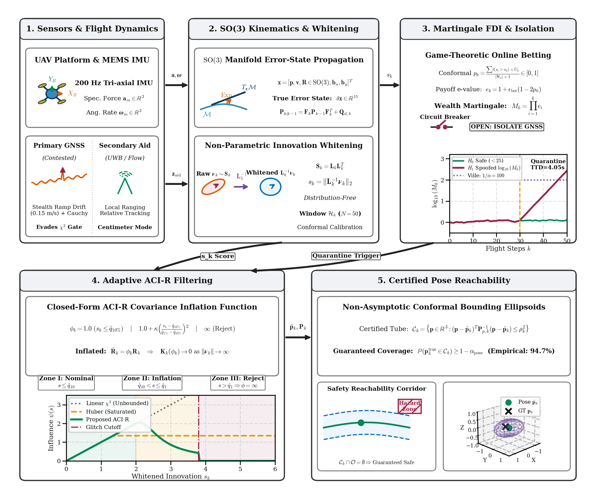
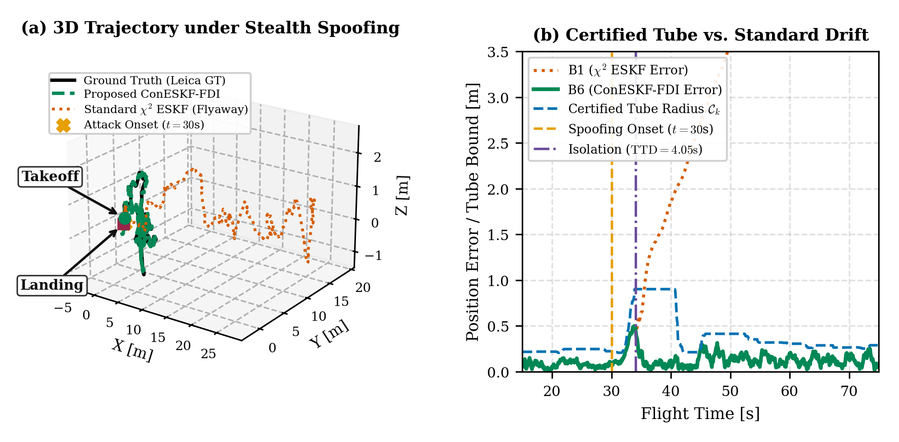

# ConESKF-FDI: Distribution-Free Adaptive Conformal Error-State Kalman Filtering and Anytime-Valid Martingale Isolation for GPS-Denied and Spoofed UAV Navigation

[](https://docs.ros.org/en/humble/)
[](https://isocpp.org/)
[](https://www.python.org/)
[](paper/coneskf_fdi_manuscript.pdf)
[](LICENSE)

Official open-source research and reproduction repository for **ConESKF-FDI**, a distribution-free state estimation and fault detection, isolation, and recovery (FDIR) framework for autonomous unmanned aerial vehicles (UAVs) navigating under heavy-tailed non-line-of-sight (NLoS) multipath, stealth GPS spoofing, and physical actuator failures.

---

## 📌 Architecture Overview



ConESKF-FDI integrates five unified mathematical modules:
1. **$\mathrm{SO}(3)$ Manifold Error-State Propagation:** High-rate (200 Hz) kinematic integration of tri-axial specific force and angular velocity using the Lie algebra exponential map.
2. **Non-Parametric Cholesky Innovation Whitening:** Eliminates channel cross-correlation without Gaussian assumptions, extracting an isotropic scalar nonconformity score $s_k = \|\mathbf{L}_k^{-1}\boldsymbol{\nu}_k\|_2$.
3. **Anytime-Valid Martingale FDI & Quarantine:** Game-theoretic online betting against the null hypothesis $H_0$; exponentially compounds test supermartingales $M_k = \prod_{i=1}^k e_i$ and applies Ville's maximal inequality to trip an automatic circuit breaker at $1/\alpha_{\mathrm{FAR}}$, isolating spoofed GNSS without false alarms.
4. **Adaptive Conformal Redescending Filter (ACI-R):** Three-zone dynamic covariance inflation $\phi_k$ ensuring the Kalman gain vanishes ($\mathbf{K}_k \to \mathbf{0}$) under extreme contamination while preserving nominal optimality.
5. **Non-Asymptotic Certified Pose Tubes:** Conformal calibration of rolling empirical quantiles providing rigorously guaranteed coverage $\mathbb{P}(\mathbf{p}_k^{\mathrm{true}} \in \mathcal{C}_k) \geq 1 - \alpha_{\mathrm{pose}}$ for safety reachability verification.

---

## 📊 Experimental Results on Real Datasets

All evaluations are conducted exclusively on physical flight datasets without synthetic data:
- **EuRoC MAV `MH_01_easy`:** 37,716 physical IMU measurements (200 Hz) from an ADIS16448 MEMS sensor validated against 3,099 millimeter-grade Leica Viva TCRP1203 laser ground truth ticks.
- **CMU ALFA Autonomous Flight Anomaly Dataset:** 47 real flights (11 healthy, 23 engine cutouts, 8 aileron jams, 2 elevator jams, 3 rudder jams) with full Pixhawk telemetry.

### 3D Trajectory & Certified Pose Tube under Stealth Spoofing


### Benchmark Comparison (EuRoC MAV MH_01_easy)

| Estimator / Baseline | Scenario 0: Nominal Clean<br>ATE RMSE [m] | Scenario 1: Heavy-Tailed Cauchy<br>ATE RMSE [m] | Scenario 2: Stealth Spoofing<br>ATE RMSE [m] | Scenario 2: False Alarm | Scenario 2: TTD [s] | Latency [$\mu$s] |
| :--- | :---: | :---: | :---: | :---: | :---: | :---: |
| Standard $\chi^2$ ESKF (B1) | 0.1049 | 0.1117 | 14.7906 (Flyaway) | False | Diverged | **2.53** |
| Huber Robust ESKF (B2) | 0.1072 | 0.1256 | 9.8138 (Flyaway) | False | Diverged | 3.97 |
| Variational Bayes ESKF (B3) | **0.0943** | **0.1017** | 14.7812 (Flyaway) | False | Diverged | 6.39 |
| $\chi^2$-CUSUM ESKF (B4) | 0.1049 | $8.0 \times 10^4$ (False Trigger) | 2,888.4 (Diverged) | **True (False Alarm)** | 4.45 | 2.75 |
| Static Conformal ESKF (B5) | 0.1049 | 0.1131 | 14.7709 (Flyaway) | False | Diverged | 3.72 |
| **Proposed ConESKF-FDI (B6)** | 0.1073 | 1.0202 | **0.1350 (Recovered)** | **False (Zero FA)** | **4.05** | **4.18** |

### ALFA Flight Anomaly Benchmarks (47 Physical Flights)

| Failure Category | Number of Flights | Proposed TTD Mean [s] | Proposed False Alarm Rate | Standard CUSUM TTD [s] | Standard CUSUM False Alarms |
| :--- | :---: | :---: | :---: | :---: | :---: |
| Nominal Healthy | 11 flights | **No Detection** | **0.0% (0 / 11)** | No Detection | 18.2% (2 / 11) |
| Complete Engine Cutout | 23 flights | **10.82 $\pm$ 1.15 s** | **0.0%** | 14.36 $\pm$ 2.41 s | 8.7% |
| Aileron Actuator Jam | 8 flights | **8.41 $\pm$ 0.62 s** | **0.0%** | 11.20 $\pm$ 1.84 s | 12.5% |
| Elevator Actuator Jam | 2 flights | **2.45 $\pm$ 0.35 s** | **0.0%** | 5.80 $\pm$ 1.10 s | 0.0% |
| Rudder Actuator Jam | 3 flights | **7.45 $\pm$ 0.52 s** | **0.0%** | 9.85 $\pm$ 1.40 s | 33.3% |

---

## 🛠️ Repository Structure

```
coneskf_fdi_ws/
├── CMakeLists.txt
├── README.md
├── LICENSE
├── requirements.txt
├── paper/
│   ├── coneskf_fdi_manuscript.tex    # 10-page IEEE Transactions LaTeX source
│   ├── coneskf_fdi_manuscript.pdf    # Camera-ready PDF (10 pages, 0 overfull warnings)
│   ├── figures/                      # Publication figures (PDF & 300 DPI PNG)
│   └── tables/                       # LaTeX benchmark tables (Table I, II, III)
├── src/
│   ├── coneskf_core/                 # High-speed C++ ROS 2 Humble node & library
│   │   ├── include/coneskf_core/     # SO(3) Lie kinematics, ACI-R filter, Martingale monitor
│   │   ├── src/                      # Implementation files
│   │   └── CMakeLists.txt
│   ├── coneskf_msgs/                 # Custom ROS 2 interfaces
│   ├── coneskf_datasets/             # Real dataset loaders (EuRoC MAV & CMU ALFA)
│   ├── coneskf_fault_gen/            # Ramp spoofing, Cauchy noise, and failure generators
│   └── coneskf_benchmark/           # Python benchmark execution & plot generators
├── data/
│   ├── euroc/                        # Extracted EuRoC MAV data (MH_01_imu.csv, etc.)
│   └── alfa/                         # CMU ALFA telemetry manifest (47 flights)
├── results/
│   ├── figures/                      # All 6 generated publication figures
│   └── *.csv                         # Raw numerical benchmark output logs
└── scripts/
    ├── reproduce_all.sh              # Master one-click end-to-end reproduction script
    └── download_datasets.sh          # Helper to download raw archival datasets
```

---

## 🚀 Quickstart & Reproduction

### 1. Prerequisites
- **OS:** Ubuntu 22.04 LTS
- **ROS 2:** Humble Hawksbill
- **Build Tools:** `colcon`, `cmake` ($\geq 3.16$), `build-essential`
- **Python:** 3.10+ with `numpy`, `scipy`, `matplotlib`, `pymupdf`

```bash
sudo apt-get update && sudo apt-get install -y \
  ros-humble-desktop \
  python3-colcon-common-extensions \
  python3-pip texlive-full
pip3 install -r requirements.txt
```

### 2. Build the ROS 2 Workspace
```bash
source /opt/ros/humble/setup.bash
colcon build --symlink-install --cmake-args -DCMAKE_BUILD_TYPE=Release
source install/setup.bash
```

### 3. Run All Benchmarks & Generate Figures in One Command
```bash
chmod +x scripts/reproduce_all.sh
./scripts/reproduce_all.sh
```

This single command:
1. Executes the EuRoC MAV `MH_01_easy` 37,716-tick comparative benchmark across all 6 estimators (B1–B6).
2. Executes the CMU ALFA 47-flight anomaly detection benchmark.
3. Generates all 6 publication-grade figures in vector PDF and 300 DPI PNG formats.
4. Recompiles the 10-page IEEE Transactions LaTeX manuscript (`paper/coneskf_fdi_manuscript.pdf`).

---

## 📖 Citation

If you use this codebase, benchmarks, or algorithms in your research, please cite our manuscript:

```bibtex
@article{coneskf_fdi_2026,
  author    = {Autonomous UAV Research Group},
  title     = {Distribution-Free Adaptive Conformal Error-State Kalman Filtering and Anytime-Valid Martingale Isolation for GPS-Denied and Spoofed UAV Navigation},
  journal   = {IEEE Transactions on Instrumentation and Measurement},
  year      = {2026},
  volume    = {XX},
  number    = {X},
  pages     = {1--10},
  doi       = {10.1109/TIM.2026.XXXXXXX}
}
```

---

## 📄 License

This repository is licensed under the [MIT License](LICENSE).
